# 04 · User Flows

Each flow has a diagram (Mermaid source in `design/flows/*.mmd`, rendered `*.svg` next to it), the step-by-step behaviour, and the edge cases engineering must handle. GitHub and VS Code render the Mermaid blocks below directly.

---

## Flow 1 — Install, first launch & permissions

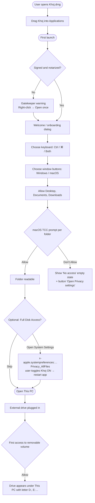

**Steps**
1. The user opens `Khoj-1.0.0-universal.dmg`. The DMG window shows the Khoj icon, an arrow and an Applications shortcut, on a background image that says "Drag to Applications".
2. First launch: macOS Gatekeeper checks the notarization ticket. If the app is unsigned (personal builds), the user must right-click → Open once.
3. The **Welcome** dialog appears (screen 15) and asks for:
   - Keyboard: **Windows (Ctrl)** / **Mac (⌘)** / **Both** (default Both)
   - Window buttons: **Windows style** (default) / **macOS style**
4. "Allow" triggers a read of `~/Desktop`, `~/Documents` and `~/Downloads`. macOS shows one TCC prompt per folder with our `Info.plist` text.
5. "Open System Settings" opens the Full Disk Access pane. This step is optional. The user must restart Khoj after enabling it.
6. "Get started" opens **This PC** (or Home, depending on the setting "Open Khoj to: This PC / Home").

**Edge cases**
- The user clicks *Don't Allow*: the folder shows an empty state "Khoj doesn't have permission to open this folder" with a **Grant access** button that opens `Privacy_FilesAndFolders`.
- The app was moved out of `/Applications` (App Translocation): show a banner suggesting it be moved to Applications.

---

## Flow 2 — Navigation & tabs

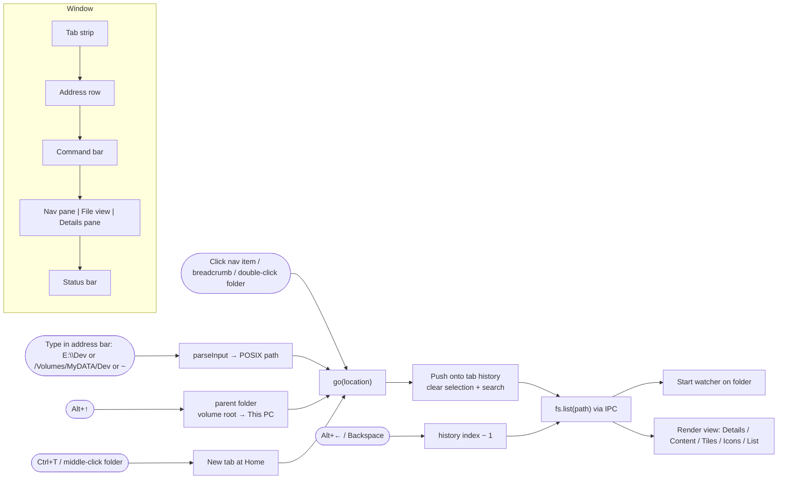

**Rules**
- Every tab has its own history stack, selection, view mode and sort.
- Single-click in the nav pane navigates. The chevron only expands or collapses.
- **Up** from a volume root goes to This PC. Up from `~` goes to Macintosh HD › Users.
- The address bar accepts: `C:\Users\you`, `E:\Dev`, `/Volumes/MyDATA/Dev`, `~`, `~/Downloads`, `This PC`, `Home`, `Gallery`, `Network`, `Trash` / `Recycle Bin`, and `smb://server/share` (mounts the share).
- Ctrl/⌘+click or middle-click a folder opens it in a new background tab.
- On relaunch, all tabs and windows are restored (stored in settings).
- The folder watcher refreshes the listing live (debounce 100 ms) and keeps the selection.

---

## Flow 3 — Copy, move, paste, drag & drop

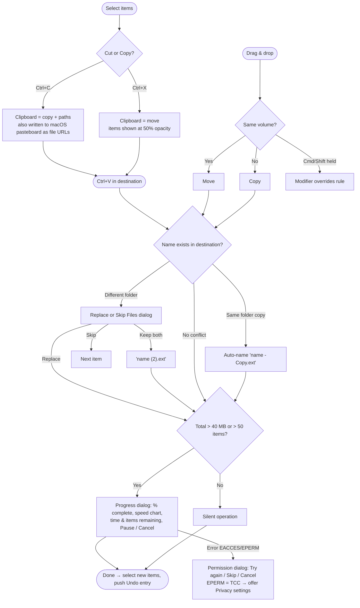

**Rules (Windows parity)**
| Action | Result |
|---|---|
| Ctrl+C → Ctrl+V in the **same** folder | Duplicate named `name - Copy.ext`, then `name - Copy (2).ext` |
| Ctrl+C → Ctrl+V into another folder with the same name present | **Replace or Skip Files** dialog (screen 14) |
| Ctrl+X → Ctrl+V | Move. Source items are drawn at 50 % opacity until pasted. Esc cancels the cut. |
| Drag on the **same** volume | Move (cursor badge "→ Move to Dev") |
| Drag to **another** volume | Copy (badge "+ Copy to Dev") |
| Drag with ⌥ Option | Force copy. Drag with ⌘ forces move. |
| Drag to Finder, Mail, Slack… | Native drag via `webContents.startDrag` |
| Drag from Finder into Khoj | Copy or move by the same rules |
| > 40 MB or > 50 items | Progress dialog (screen 13) with Pause / Cancel |
| Paste into a read-only volume | Error dialog "The disk is write-protected" |

**Clipboard interop:** Khoj also writes the copied items to the macOS pasteboard as file URLs, so ⌘V in Finder pastes them. Khoj also reads file URLs that Finder copied.

**Errors during a job:** EACCES/EPERM → dialog with **Try again / Skip / Cancel** (EPERM adds "Open Privacy settings"). ENOSPC → "There is not enough space on MyDATA (E:). You need an additional 1.2 GB." Name too long → **Skip / Rename**.

---

## Flow 4 — Delete, Trash & Undo

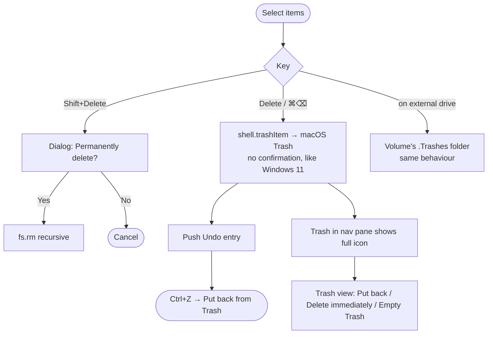

- **Delete** / ⌘⌫ moves items to the macOS Trash immediately, with no confirmation (the Windows 11 default). The Trash icon in the nav pane switches to "full".
- **Shift+Delete** permanently deletes after a confirmation dialog (default button = No).
- **Ctrl/⌘+Z** puts back the last deleted batch (we keep the Trash path that `trashItem` produced).
- Trash view: columns Name · Date deleted · Original location · Size. Commands: Restore, Empty Trash.
- An option "Display delete confirmation dialog" (Windows Recycle Bin property) defaults to off.

---

## Flow 5 — Rename

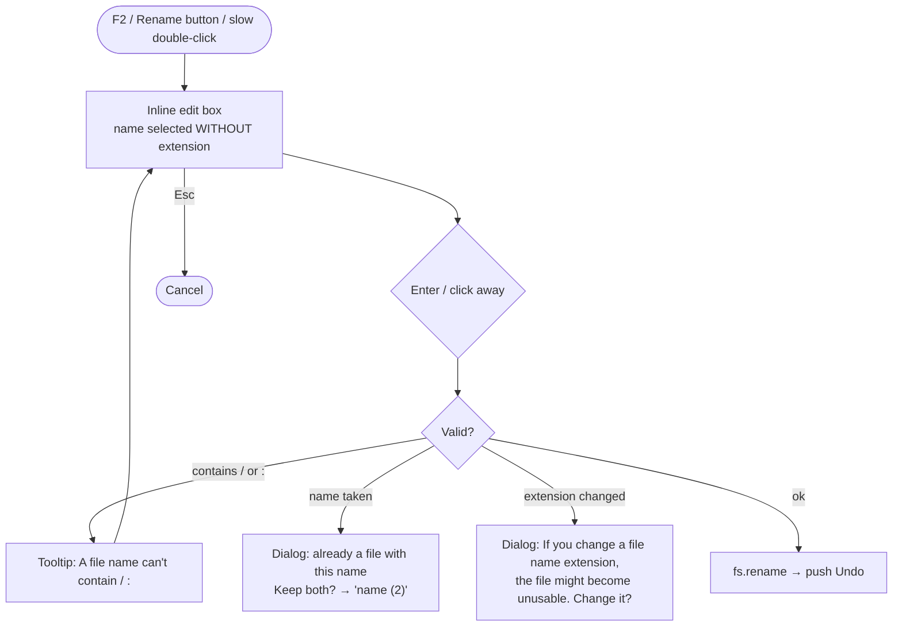

- Name selection excludes the extension (screen 20). Tab moves to the next item while still in rename mode (Windows behaviour).
- Multi-select + F2 renames all: `Photo (1).jpg`, `Photo (2).jpg`, … (Windows batch rename).
- A case-only rename on case-insensitive APFS uses a temporary name in between.

---

## Flow 6 — Drives, volumes & drive letters

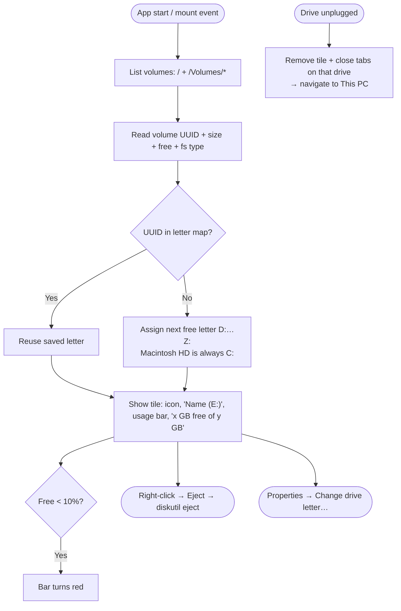

- **Macintosh HD is always C:**. Other volumes get the next free letter starting at **D:**, stored by **volume UUID**, so the same USB drive always gets the same letter (like Windows).
- The user can change a letter in drive Properties ("Change drive letter…"). Two volumes can never share a letter.
- Letters are a **display layer** only. Underneath, paths stay `/Volumes/<Name>`. Typing `E:\Dev` in the address bar resolves to the volume that owns E:.
- Hidden system volumes (Preboot, Recovery, VM, Data) are not shown. Disk images (`.dmg`) appear as drives with the disk-image icon and an Eject button.
- Unplug while browsing: affected tabs fall back to This PC and a short info bar appears: "MyDATA (E:) was removed."

---

## Flow 7 — Search
1. Ctrl/⌘+E or F3 focuses search, with "Search MyDATA (E:)" as the placeholder.
2. Typing filters by name immediately. The background job walks sub-folders with a 1,000-results cap and streams results in.
3. Results use the Details view with a **Folder** column (screen 12). Enter on a result opens it. "Open file location" is in the context menu.
4. P1: Spotlight-backed search (`mdfind -onlyin <path> <query>`) with filters (Kind, Date modified, Size), saved in a "Recent searches" dropdown.

## Flow 8 — Open & preview
- Double-click / Enter → `shell.openPath` (default app). Folders navigate. `.app` launches.
- Space → native Quick Look panel (`win.previewFile`). Space again closes it, and arrow keys move the selection while it stays open.
- Open with ▸ → list of apps that can open the type, plus "Choose another app…" (native picker).

## Flow 9 — Settings sync & persistence
- Stored in `~/Library/Application Support/Khoj/settings.json`: theme, window style, keyboard scheme, letters map, pinned folders, per-folder view state (keyed by path), tabs/windows to restore, nav width, details pane on/off.
- Settings changes apply live, with no restart.
