# 06 · Technical Architecture

> Stack decision (see research §6): **Electron + React + TypeScript**. The UI layer only talks to a small, typed IPC API, so the backend can later be swapped for Tauri without touching the UI.



## 1. Stack
| Layer | Choice | Why |
|---|---|---|
| Shell | **Electron** (latest stable at project start; 44.x/45.x in Oct 2026) | Chromium + Node, rich macOS APIs |
| Build | **electron-vite** (Vite for main, preload, renderer) | Fast HMR, simple config |
| UI | **React** + **TypeScript** | Component model fits Explorer's many panes |
| Styling | Plain CSS + the token file `design/tokens/tokens.css` | Pixel control, no framework fighting the Windows look |
| State | **Zustand** | Small, works per window |
| Lists | **@tanstack/react-virtual** | 10k+ rows at 60 fps |
| Watcher | **@parcel/watcher** (FSEvents backend), fallback `fs.watch` | Efficient recursive watching |
| Volumes | `fs.statfs` + **@photostructure/fs-metadata** (mount points, UUID, hidden flag) | Drive tiles and stable letters |
| Settings | **electron-store** (JSON in Application Support) | Simple, atomic writes |
| Packaging | **electron-builder** → universal DMG, notarized | Mature mac support |
| Tests | **Vitest** (unit) + **Playwright for Electron** (E2E) | |

> Package versions: pin the newest stable releases on day 1 and commit the lockfile. This kit couldn't query npm while being written.

## 2. Repository layout
```
khoj/
├─ package.json
├─ electron.vite.config.ts
├─ electron-builder.yml
├─ build/                      # packaging assets
│  ├─ icon.icns                # ← icons/app-icon/Khoj.icns
│  ├─ dmg-background.png       # 660×400 @1x + @2x
│  ├─ entitlements.mac.plist
│  └─ entitlements.mac.inherit.plist
├─ resources/fonts/Selawik/    # selawk*.ttf + OFL.txt
├─ src/
│  ├─ main/                    # Node side
│  │  ├─ index.ts              # app lifecycle, windows, native menu
│  │  ├─ window.ts             # BrowserWindow factory (chrome options)
│  │  ├─ ipc.ts                # ipcMain.handle registry + validation
│  │  ├─ services/
│  │  │  ├─ fs.service.ts      # list, stat, mkdir, rename, exists
│  │  │  ├─ ops.service.ts     # copy/move/delete queue with progress
│  │  │  ├─ watch.service.ts   # folder watchers
│  │  │  ├─ volumes.service.ts # volumes, statfs, mount events, letters
│  │  │  ├─ icons.service.ts   # getFileIcon + thumbnails + cache
│  │  │  ├─ shell.service.ts   # open, reveal, trash, quicklook, drag, terminal
│  │  │  └─ settings.service.ts
│  │  └─ util/paths.ts         # display ⇄ POSIX conversion, drive letters
│  ├─ preload/index.ts         # contextBridge → window.khoj
│  ├─ shared/types.ts          # IPC contracts shared by main + renderer
│  └─ renderer/
│     ├─ index.html
│     ├─ styles/tokens.css     # ← design/tokens/tokens.css
│     ├─ assets/icons/         # ← icons/** (SVG sprite)
│     ├─ store/                # tabs, selection, clipboard, settings slices
│     ├─ components/           # TitleBar, Tabs, CaptionButtons, AddressBar,
│     │                        # Breadcrumb, SearchBox, CommandBar, NavPane,
│     │                        # views/{Details,Content,Tiles,Icons,List},
│     │                        # DetailsPane, StatusBar, Menu, Dialog…
│     ├─ pages/                # Home, Gallery, ThisPC, Network, Trash, Folder
│     ├─ keyboard/shortcuts.ts # one table drives renderer + native menu
│     └─ App.tsx
└─ tests/ (unit + e2e)
```
The clickable prototype (`design/prototype/src/app.js`) already contains working reference logic for path display, breadcrumbs, sorting, selection, the undo stack, paste naming and the shortcut table. Port it into the store and components.

## 3. Window & chrome
```ts
// src/main/window.ts
import { BrowserWindow, nativeTheme } from 'electron';
import path from 'node:path';

export function createMainWindow(opts: { macButtons: boolean }) {
  const win = new BrowserWindow({
    width: 1280, height: 800, minWidth: 640, minHeight: 400,
    titleBarStyle: 'hidden',                 // remove macOS title bar
    trafficLightPosition: { x: 14, y: 10 },  // used only when macButtons = true
    vibrancy: 'under-window',                // Mica-like backdrop (CSS adds tint)
    visualEffectState: 'followWindow',
    backgroundColor: nativeTheme.shouldUseDarkColors ? '#202020' : '#F3F3F3',
    show: false,
    webPreferences: {
      preload: path.join(__dirname, '../preload/index.js'),
      contextIsolation: true, sandbox: true, nodeIntegration: false,
      spellcheck: false,
    },
  });
  win.setWindowButtonVisibility(opts.macButtons); // hide traffic lights → draw Windows buttons
  win.once('ready-to-show', () => win.show());
  return win;
}
```
- Windows-style caption buttons are React components that call `khoj.window.minimize() / toggleMaximize() / close()`. "Maximise" uses `win.maximize()` (zoom to the visible screen), not native full screen.
- Drag region: `.tabstrip { -webkit-app-region: drag }`, and every button/tab gets `-webkit-app-region: no-drag`.
- When maximised, set `border-radius: 0` (Windows rule) using an IPC event `window:maximized-changed`.

## 4. IPC contract (`src/shared/types.ts`)
```ts
export type Path = string;                      // always POSIX inside the app
export interface Entry {
  name: string; path: Path; kind: 'file' | 'dir' | 'symlink' | 'package';
  size: number; mtimeMs: number; birthtimeMs: number;
  hidden: boolean; readonly: boolean; ext: string;
  cloud?: 'local' | 'cloud-only' | 'downloading';   // iCloud / File Provider
  hasSubdirs?: boolean;                            // filled lazily for the nav tree
}
export interface Volume {
  id: string;            // volume UUID
  name: string; mount: Path; letter: string;   // letter is display-only
  kind: 'system' | 'external' | 'usb' | 'network' | 'image';
  fsType: string; total: number; free: number; readonly: boolean; ejectable: boolean;
}
export interface OpProgress {
  opId: string; kind: 'copy' | 'move' | 'delete';
  bytesDone: number; bytesTotal: number; itemsDone: number; itemsTotal: number;
  current: string; speedBps: number; state: 'running' | 'paused' | 'done' | 'error' | 'cancelled';
  error?: { code: string; path: string; message: string };
}
export type Conflict = 'replace' | 'skip' | 'keep-both' | 'ask';

export interface KhojAPI {
  fs: {
    list(dir: Path, o?: { hidden?: boolean }): Promise<Entry[]>;   // streamed in chunks via events for huge dirs
    stat(p: Path): Promise<Entry>;
    mkdir(parent: Path, name: string): Promise<Path>;
    rename(p: Path, newName: string): Promise<Path>;
    search(root: Path, q: string): AsyncIterable<Entry>;            // via event stream
    resolveInput(text: string): Promise<Path | 'thispc' | 'home' | 'gallery' | 'network' | 'trash' | null>;
  };
  ops: {
    copy(src: Path[], dest: Path, conflict: Conflict): Promise<string>;  // returns opId
    move(src: Path[], dest: Path, conflict: Conflict): Promise<string>;
    trash(paths: Path[]): Promise<{ restored: () => void } | void>;
    deletePermanently(paths: Path[]): Promise<void>;
    pause(opId: string): void; resume(opId: string): void; cancel(opId: string): void;
    onProgress(cb: (p: OpProgress) => void): () => void;
    onConflict(cb: (c: { opId: string; src: Entry; dest: Entry }) => Promise<Conflict>): () => void;
  };
  volumes: { list(): Promise<Volume[]>; eject(id: string): Promise<void>; setLetter(id: string, l: string): Promise<void>; onChange(cb: (v: Volume[]) => void): () => void };
  watch: { subscribe(dir: Path, cb: (changes: { type: 'create' | 'update' | 'delete'; path: Path }[]) => void): () => void };
  icons: { forPath(p: Path, size: 16 | 32): Promise<string /* dataURL */>; thumbnail(p: Path, px: number): Promise<string | null> };
  shell: {
    open(p: Path): Promise<void>; openWith(p: Path, appPath: Path): Promise<void>; appsFor(p: Path): Promise<{ name: string; path: Path; icon: string }[]>;
    reveal(p: Path): void; quickLook(p: Path): void; startDrag(paths: Path[]): void;
    openTerminal(dir: Path): void; share(paths: Path[]): void; copyPaths(paths: Path[], style: 'windows' | 'posix'): void;
    zip(paths: Path[]): Promise<Path>; unzip(p: Path, dest: Path): Promise<void>;
    openPrivacySettings(pane: 'files' | 'fulldisk'): void;
  };
  clipboard: { writeFiles(paths: Path[], cut: boolean): void; readFiles(): Promise<{ paths: Path[]; cut: boolean }> };
  window: { minimize(): void; toggleMaximize(): void; close(): void; newWindow(at?: Path): void; onMaximized(cb: (m: boolean) => void): () => void };
  settings: { get<T>(k: string): Promise<T>; set<T>(k: string, v: T): Promise<void>; onChange(cb: (k: string, v: unknown) => void): () => void };
}
declare global { interface Window { khoj: KhojAPI } }
```
**Rule:** the renderer never builds shell commands. All arguments are validated in `ipc.ts` (absolute path, exists, no NUL, inside allowed roots), and every child process uses `execFile` with an argument array (never a shell string).

## 5. Services — key implementation notes

### 5.1 Listing folders fast
```ts
// fs.service.ts (sketch)
import { opendir, lstat } from 'node:fs/promises';
export async function list(dir: string, showHidden = false) {
  const out: Entry[] = []; const d = await opendir(dir, { bufferSize: 256 });
  const batch: Promise<void>[] = [];
  for await (const de of d) {
    if (!showHidden && de.name.startsWith('.')) continue;
    batch.push(lstat(`${dir}/${de.name}`).then(st => { out.push(toEntry(dir, de, st)); }).catch(() => {}));
    if (batch.length >= 64) { await Promise.all(batch); batch.length = 0; }
  }
  await Promise.all(batch);
  return out;            // UF_HIDDEN flag: read via fs-metadata isHidden() in a second pass for visible rows only
}
```
- For folders with more than 2,000 entries, send results in chunks (`list:chunk` events) so the first screen paints immediately.
- Never `stat` network volumes recursively during navigation. Compute `hasSubdirs` lazily for visible nav rows only.
- Treat `.app`, `.bundle`, `.framework`, `.photoslibrary`, `.pages` etc. as `kind: 'package'` (UTI check via `mdls -name kMDItemContentTypeTree`, cached per extension).

### 5.2 Copy / move with progress (ops.service)
- **Same volume move** → `fs.rename` (instant). **Cross-volume move** → copy, verify, then delete the source.
- **Copy** walks the tree first to compute totals (items and bytes), then copies file by file with `fs.copyFile(src, dst, fs.constants.COPYFILE_FICLONE)`. On APFS this clones instantly where possible, and libuv uses `copyfile(3)` on macOS, which keeps metadata/xattrs.
- **Byte-level progress for big files without losing metadata:** while `copyFile` runs (thread pool), poll `fs.stat(dst).size` every 250 ms to update `bytesDone`. Small files update per item.
- Pause = await a gate between files. Cancel = stop and delete the partially-copied current file.
- Conflicts: `ask` → emit `op:conflict` and await the renderer's choice (with "Do this for all conflicts" checkbox).
- Errors map to Windows-style dialogs: `EACCES`/`EPERM` (TCC) / `ENOSPC` / `ENAMETOOLONG` / `EROFS` (read-only, e.g. NTFS).
- Naming helpers (already in the prototype): `"name - Copy.ext"`, `"name - Copy (2).ext"`, `"name (2).ext"`.
- Undo stack (in main, per window): record `{ type, from, to }` for rename / new / move / copy / trash.

### 5.3 Trash
- `shell.trashItem(path)` moves to the correct Trash (home or the volume's `.Trashes`).
- Undo needs the new location: scan `~/.Trash` (or `/Volumes/X/.Trashes/<uid>`) for the newest item with the same base name immediately after trashing, and store it in the undo record. The Trash view lists those folders. Reading `~/.Trash` may be blocked by macOS privacy protection without Full Disk Access. In that case, show "Open Trash in Finder" instead of an error.

### 5.4 Volumes & drive letters
```ts
// volumes.service.ts (sketch)
import { statfs } from 'node:fs/promises';
import { getVolumeMountPoints, getVolumeMetadata } from '@photostructure/fs-metadata';
const letters = settings.get('driveLetters', {} as Record<string /*uuid*/, string>);
export async function listVolumes(): Promise<Volume[]> {
  const mps = (await getVolumeMountPoints()).filter(isUserVisible);   // drop /System/Volumes/*, Preboot, VM…
  const vols = await Promise.all(mps.map(async mp => {
    const md = await getVolumeMetadata(mp.mountPoint); const s = await statfs(mp.mountPoint);
    return { id: md.uuid ?? mp.mountPoint, name: md.label ?? basename(mp.mountPoint), mount: mp.mountPoint,
      total: s.blocks * s.bsize, free: s.bavail * s.bsize, fsType: md.fstype, readonly: !!md.readonly, ... };
  }));
  return assignLetters(vols);   // '/' → C, others keep saved letter, else next free from D
}
```
- Mount/unmount detection: watch `/Volumes` with `fs.watch` + debounce 500 ms, then re-list. Electron `powerMonitor`/`systemPreferences` events aren't needed.
- Eject: `execFile('diskutil', ['eject', mount])`. Show "This device is currently in use" when it fails with "busy".

### 5.5 Icons & thumbnails
- **Windows look first:** common types (folders, txt, pdf, docx, xlsx, pptx, images, audio, video, zip, code, dmg) use the **kit's SVG icons**. The macOS document icons would break the Windows feel.
- **Native icons** for `.app` bundles, unknown types and folders with custom icons: `app.getFileIcon(path, { size: 'small' | 'normal' })` (16 / 32. `large` isn't supported on macOS). Cache by extension, or by path for apps.
- **Thumbnails** (Large/Medium/Tiles/Gallery/Details pane): `nativeImage.createThumbnailFromPath(path, { width, height })`, cached as PNG in `~/Library/Caches/Khoj/thumbs/<sha1(path+mtime+size)>.png`. Concurrency limit 4 and an LRU of 2,000 in memory.

### 5.6 Watching
- One `@parcel/watcher` subscription per **open folder** (not recursive across the volume). Debounce 100 ms and apply diffs to the store (keeps scroll position and selection).
- Network volumes: polling every 5 s while visible (FSEvents is unreliable on SMB).

### 5.7 Clipboard interop with Finder
- Copy: keep the internal clipboard (paths + cut flag) **and** write file URLs to the pasteboard so Finder can paste: `clipboard.writeBuffer('NSFilenamesPboardType', Buffer.from(plistOf(paths)))` plus `public.file-url` for the first item. This is widely used in Electron apps but undocumented, so verify on the target macOS version. If it misbehaves, move it into a ~40-line Objective-C native addon using `NSPasteboard writeObjects:` with `NSURL`s.
- Paste: read `NSFilenamesPboardType` / `public.file-url` from the pasteboard if the internal clipboard is empty.
- Cut from Finder isn't a thing (Finder uses ⌘⌥V to move), so Khoj's cut works only inside Khoj, plus ⌘⌥V from Finder-copied files.

### 5.8 Drag & drop
- Out of the app: `onDragStart` → `khoj.shell.startDrag(paths)` → `event.sender.startDrag({ files: paths, icon })`.
- Into the app: standard HTML5 `drop`, then call `webUtils.getPathForFile(file)` in the preload to get real paths (`File.path` was removed in recent Electron versions). Apply the same-volume rule.
- Hover-to-open: hovering over a folder/nav item for 700 ms while dragging navigates or expands it.

### 5.9 Keyboard
- One table, `keyboard/shortcuts.ts` (see `07-keyboard-shortcuts.md`), generates:
  1. The **native macOS menu** (File/Edit/View/Go/Window/Help) with `CmdOrCtrl` accelerators. This is required for VoiceOver and macOS conventions.
  2. A renderer key handler for Ctrl variants (in "Both"/"Ctrl" modes) and Windows-only keys (F2, F5, Delete, Backspace, Alt+arrows).
- The mode setting decides whether Ctrl, ⌘ or both are active. Never bind ⌘H/⌘Q/⌘Space/⌘Tab, which belong to the system.

### 5.10 Theme & vibrancy
- `nativeTheme.themeSource = 'system' | 'light' | 'dark'`. Renderer sets `data-theme` from `nativeTheme.shouldUseDarkColors` + the `updated` event.
- With vibrancy on, the tab strip and address row use translucent fills (`rgba(32,32,32,.82)`) over the vibrant backdrop. Respect "Reduce transparency" (`nativeTheme.prefersReducedTransparency` in recent Electron, or the CSS media query `prefers-reduced-transparency`) by switching to the solid colours.
- Fonts: `@font-face { font-family: Selawik; src: url(../fonts/selawk.ttf) }` plus semibold/semilight/bold variants.

## 6. Performance budget
| Item | Budget |
|---|---|
| Main window first paint | < 600 ms after launch |
| Folder list ≤ 2k items | < 100 ms IPC + render |
| Folder list 10k items | first chunk < 150 ms, total < 300 ms |
| Scroll | 60 fps (virtualised rows, icons from the sprite, thumbnails lazy) |
| Memory idle (1 window, 3 tabs) | < 250 MB |

## 7. Security checklist
- `contextIsolation: true`, `sandbox: true`, `nodeIntegration: false`, strict CSP (`default-src 'self'; img-src 'self' data: blob:`).
- No remote URLs loaded. Block `will-navigate` and `setWindowOpenHandler(() => ({ action: 'deny' }))`.
- Validate every IPC argument. Paths are normalised with `path.resolve`, rejected if they contain NUL, and always used with `execFile` (no shell).
- Electron Fuses: disable `RunAsNode`, `EnableNodeCliInspectArguments`; enable `EnableEmbeddedAsarIntegrityValidation`, `OnlyLoadAppFromAsar`.
- Auto-update over HTTPS only, with signed updates (electron-updater + notarized zip).

## 8. Packaging (electron-builder)
```yaml
# electron-builder.yml
appId: com.yourname.khoj
productName: Khoj
copyright: © 2026 Your Name
directories: { output: dist, buildResources: build }
files: [ "out/**", "resources/**", "package.json" ]
asar: true
mac:
  category: public.app-category.productivity
  target:
    - { target: dmg, arch: [universal] }
    - { target: zip, arch: [universal] }        # for auto-update
  icon: build/icon.icns
  hardenedRuntime: true
  gatekeeperAssess: false
  entitlements: build/entitlements.mac.plist
  entitlementsInherit: build/entitlements.mac.inherit.plist
  notarize: true                                # uses APPLE_ID / APPLE_APP_SPECIFIC_PASSWORD / APPLE_TEAM_ID env
  minimumSystemVersion: "13.0"
  extendInfo:
    NSDesktopFolderUsageDescription: Khoj needs access to your Desktop folder to show and manage your files.
    NSDocumentsFolderUsageDescription: Khoj needs access to your Documents folder to show and manage your files.
    NSDownloadsFolderUsageDescription: Khoj needs access to your Downloads folder to show and manage your files.
    NSRemovableVolumesUsageDescription: Khoj needs access to USB and external drives to show and manage files on them.
    NSNetworkVolumesUsageDescription: Khoj needs access to network drives to show and manage files on them.
    LSApplicationCategoryType: public.app-category.productivity
dmg:
  title: "Khoj ${version}"
  background: build/dmg-background.png
  iconSize: 96
  window: { width: 660, height: 400 }
  contents:
    - { x: 180, y: 200 }
    - { x: 480, y: 200, type: link, path: /Applications }
```
```xml
<!-- build/entitlements.mac.plist (non-sandboxed, hardened runtime) -->
<?xml version="1.0" encoding="UTF-8"?>
<!DOCTYPE plist PUBLIC "-//Apple//DTD PLIST 1.0//EN" "http://www.apple.com/DTDs/PropertyList-1.0.dtd">
<plist version="1.0"><dict>
  <key>com.apple.security.cs.allow-jit</key><true/>
  <key>com.apple.security.cs.allow-unsigned-executable-memory</key><true/>
  <key>com.apple.security.cs.disable-library-validation</key><true/>  <!-- only if native addons are unsigned -->
</dict></plist>
```
- **Personal build without an Apple account:** set `mac.identity: null`, `hardenedRuntime: false` and `notarize: false`. The app runs on your Mac after right-click → Open.
- `.icns` is ready in `icons/app-icon/Khoj.icns`. You can also rebuild it on a Mac with `iconutil -c icns icons/app-icon/AppIcon.iconset`.

### CI: build the DMG without owning a Mac (GitHub Actions)
```yaml
# .github/workflows/release.yml
name: release-mac
on: { push: { tags: ['v*'] }, workflow_dispatch: {} }
jobs:
  mac:
    runs-on: macos-latest          # Apple Silicon runner; universal build covers Intel too
    steps:
      - uses: actions/checkout@v4
      - uses: actions/setup-node@v4
        with: { node-version: 24, cache: npm }
      - run: npm ci
      - run: npm run build
      - run: npx electron-builder --mac --universal --publish never
        env:
          CSC_LINK: ${{ secrets.MAC_CERT_P12_BASE64 }}        # Developer ID Application cert
          CSC_KEY_PASSWORD: ${{ secrets.MAC_CERT_PASSWORD }}
          APPLE_ID: ${{ secrets.APPLE_ID }}
          APPLE_APP_SPECIFIC_PASSWORD: ${{ secrets.APPLE_APP_SPECIFIC_PASSWORD }}
          APPLE_TEAM_ID: ${{ secrets.APPLE_TEAM_ID }}
      - uses: actions/upload-artifact@v4
        with: { name: Khoj-mac, path: dist/*.dmg }
```
For an unsigned test build, remove the `env` block and add `-c.mac.identity=null`.

## 9. Testing
| Level | What | Tool |
|---|---|---|
| Unit | path display/parse (`E:\Dev` ⇄ `/Volumes/MyDATA/Dev`), naming rules, sort, letter assignment, undo | Vitest |
| Service | copy/move/delete on a temp APFS disk image (`hdiutil create -size 200m -fs APFS`), conflicts, cancel, ENOSPC | Vitest + real FS |
| E2E | launch app, navigate, rename, copy with progress, context menu, shortcuts in all 3 keyboard modes | Playwright `_electron` |
| Visual | screenshot diff of the 22 reference screens against the prototype | Playwright |
| Manual | TCC prompts on a clean macOS user, Full Disk Access flow, external exFAT/NTFS drives, SMB share, iCloud dataless files, VoiceOver | Checklist in `09-roadmap-and-milestones.md` |
